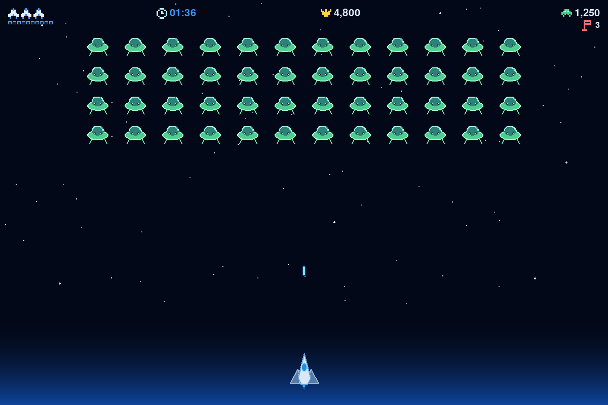
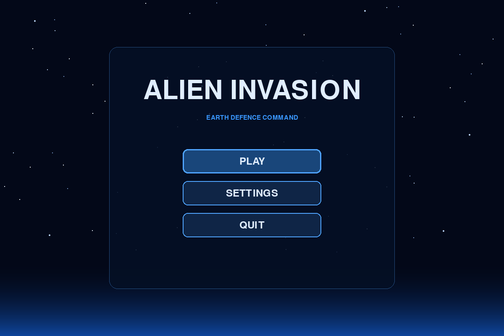
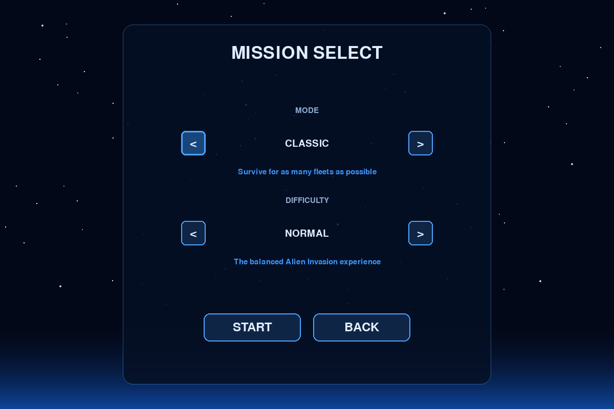
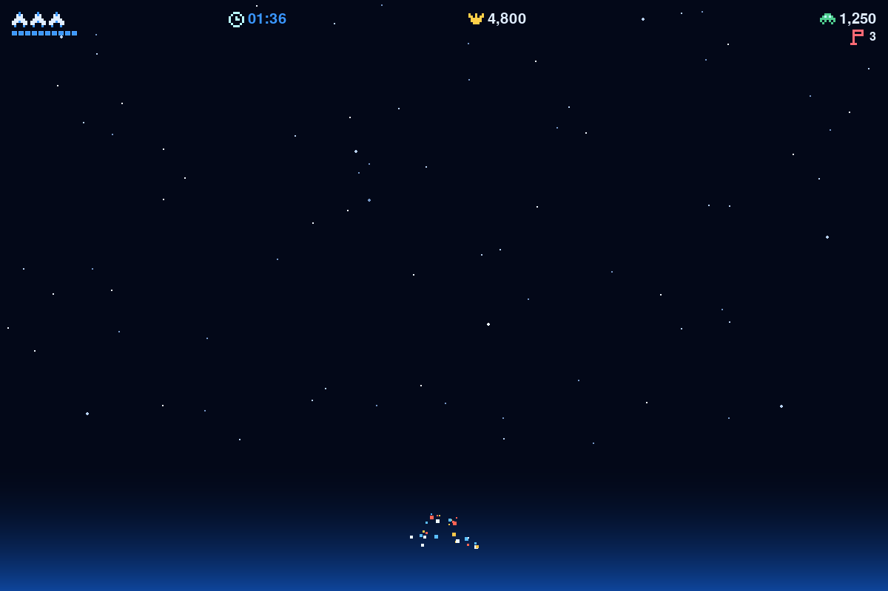

# Alien Invasion

An original, test-driven arcade shooter built with Python and Pygame. Defend
Earth from descending alien fleets, improve your score, and survive as each new
wave becomes faster.



## Highlights

- Responsive ship movement and cooldown-based shooting
- Centered alien fleets that descend, reverse, and accelerate between levels
- Classic and two-minute Time Attack game modes
- Easy, Normal, and Hard difficulty settings
- Original pixel-art HUD with ship lives and a segmented blaster meter
- Non-blocking ship explosion, recovery, pause, and game-over sequences
- Three procedural space themes and three supported resolutions
- Persistent settings, selected game options, and per-mode high scores
- Mouse and keyboard navigation throughout the interface
- Automated tests covering gameplay, scaling, storage, and visual components

## Screenshots

| Main menu | Mission selection |
| --- | --- |
|  |  |

| Gameplay | Ship explosion |
| --- | --- |
|  |  |

## Requirements

- Python 3.9 or newer
- A desktop environment capable of opening a Pygame window

## Installation

Clone the repository, then create and activate a virtual environment:

```bash
git clone <repository-url>
cd alien-invasion-pygame
python3 -m venv .venv
source .venv/bin/activate
```

On Windows PowerShell, activate the environment with:

```powershell
.venv\Scripts\Activate.ps1
```

Install the game:

```bash
python -m pip install --upgrade pip
python -m pip install -e .
```

Start playing:

```bash
alien-invasion
```

You can also run the development entry point with `python main.py`.

## Controls

| Action | Keyboard | Mouse |
| --- | --- | --- |
| Move the ship | Left/Right Arrow or `A`/`D` | — |
| Fire | Press or hold Space | — |
| Pause or resume | Escape | — |
| Navigate menus | Arrow keys or Tab | Move pointer |
| Select an option | Enter or Space | Left click |
| Return from a menu | Escape | Back button |

Only three bullets can be active at once. The segmented meter below the ship
lives shows when the blaster is ready to fire again.

## Game modes and difficulty

- **Classic:** survive for as many fleets as possible.
- **Time Attack:** earn the highest score you can within two minutes.
- **Easy:** five ships, slower fleets, and a gentler speed increase.
- **Normal:** three ships and the intended balanced experience.
- **Hard:** two ships, faster fleets, and a larger score multiplier.

Destroying an alien awards points based on the current level and difficulty.
Clearing the entire fleet awards a bonus, increases the level, and launches a
faster fleet. Fleet speed is capped to keep later levels playable.

## Saved data

The game automatically saves display preferences, the last selected mode and
difficulty, and high scores. Save data is stored outside the repository:

- macOS: `~/Library/Application Support/Alien Invasion/settings.json`
- Windows: `%LOCALAPPDATA%\Alien Invasion\settings.json`
- Linux: `$XDG_DATA_HOME/Alien Invasion/settings.json`, or
  `~/.local/share/Alien Invasion/settings.json`

Missing or damaged save files are handled safely by restoring defaults.

## Development

Install the development dependencies and Git hooks:

```bash
python -m pip install -e ".[dev]"
pre-commit install
```

Run the quality checks:

```bash
ruff check .
ruff format --check .
pytest
```

The current suite contains 65 automated tests.

## Project structure

```text
.
├── docs/                    # Player and developer documentation
│   └── images/             # Screenshots from the running game
├── src/alien_invasion/     # Installable game package
├── tests/                  # Automated test suite
├── main.py                 # Convenience development entry point
└── pyproject.toml          # Package and tool configuration
```

Read the [gameplay and feature guide](docs/gameplay-guide.md) for the complete
game rules. The [code guide](docs/code-guide.md) explains the architecture,
frame lifecycle, modules, data structures, and common extension points.

## Project background

This project was inspired by the Alien Invasion learning project in *Python
Crash Course* by Eric Matthes (No Starch Press). This implementation was
independently developed and expanded with its own architecture, procedural
visuals, interface, modes, persistence, effects, and automated tests.
