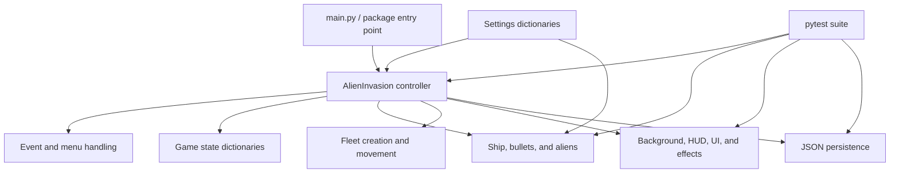

# Code and Architecture Guide

Alien Invasion is an installable Python package under `src/alien_invasion`. It
uses small classes, functions, and built-in containers so the gameplay remains
approachable while still following production-oriented practices.

## Architecture overview

`AlienInvasion` in `game.py` is the application coordinator. It owns the active
objects, processes input, updates the simulation, changes screens, and asks each
visual component to draw itself. Entity classes contain their own movement and
rendering behavior, while standalone modules handle fleet logic, persistence,
configuration, and reusable drawing.

## Application lifecycle

The console command declared in `pyproject.toml` calls
`alien_invasion.game:main`. `main()` creates `AlienInvasion` with the platform's
default save path and starts `run()`.

Each frame performs four steps:

1. `pygame.time.Clock.tick()` calculates elapsed time and limits the game to 60
   frames per second.
2. `_process_events()` handles window, keyboard, and mouse events.
3. `_update(delta_time)` advances the active simulation.
4. `_draw_current_screen()` renders the selected screen before
   `pygame.display.flip()` presents it.

Movement uses `delta_time` rather than a fixed number of pixels per frame. This
keeps ship, bullet, and alien speeds consistent if the frame rate fluctuates.
The frame delta is capped at 0.05 seconds to prevent a long pause in the host
system from causing a large physics jump.

## Screen and gameplay state

`current_screen` selects `menu`, `settings`, `game_options`, or `game`. Inside
the game screen, `game_active`, `paused`, `explosion`, and
`recovery_remaining` describe the current gameplay sub-state.

The update order matters:

1. Inactive screens do not update gameplay.
2. Paused games freeze all timers.
3. An active explosion advances until life removal can finish.
4. Recovery finishes before a new fleet is created.
5. The Time Attack clock is updated and can end the game.
6. Ship, bullets, fleet movement, collisions, and threats are processed.

This ordering prevents duplicate life loss, movement during explosions, or a
timer continuing while paused.

## Module responsibilities

| Module | Responsibility |
| --- | --- |
| `game.py` | Main loop, state transitions, collision orchestration, scoring, menus, and drawing order |
| `settings.py` | Resolutions, themes, colors, entity tuning, modes, difficulties, and score values |
| `ship.py` | Horizontal player movement, boundary clamping, scaling, and procedural ship art |
| `bullet.py` | Projectile movement, off-screen detection, scaling, and drawing |
| `alien.py` | Individual alien position, edge detection, movement, and procedural art |
| `fleet.py` | Responsive fleet construction, edge drops, direction reversal, and group movement |
| `scoreboard.py` | Cached score labels, pixel icons, life ships, timer, level, and cooldown meter |
| `effects.py` | Time-based pixel-particle explosion effect |
| `pixel_art.py` | Reusable icon patterns and palette-based icon generation |
| `screens.py` | Deterministic star fields, atmospheric gradients, panels, and text helpers |
| `ui.py` | Reusable mouse- and keyboard-aware button component |
| `storage.py` | Platform save paths, defensive JSON loading, and atomic writes |

## Core data structures

The project intentionally uses fundamental Python containers:

- `list[Bullet]` and `list[Alien]` hold the active entities. List
  comprehensions remove collisions and off-screen objects.
- Dictionaries in `settings.py` group tunable configuration without requiring
  a database or configuration framework.
- `game_stats` stores score, high score, level, ships, timer, and active state.
- `game_options` stores the current mode and difficulty.
- `high_scores` uses `(mode, difficulty)` tuples as keys, giving each
  combination its own score.
- Tuples represent immutable positions, sizes, resolutions, and RGB colors.
- Explosion particles are dictionaries inside a list, with angle, speed, size,
  and color values.

## Entity movement and scaling

The ship stores its horizontal position as a float for smooth motion, then
rounds it when updating the Pygame rectangle. Its direction is calculated from
the two Boolean values in the `movement` dictionary. Clamping keeps the entire
ship within the display.

Bullets store a floating-point vertical position and move upward according to
elapsed time. Aliens follow the same time-based approach horizontally. Their
visual dimensions and speeds are derived from a reference resolution so the
game feels consistent at every supported size.

`create_fleet()` calculates how many configured columns fit between the side
margins. It creates the requested number of rows and centers the resulting grid.
`update_fleet()` checks all aliens before movement; when one reaches an edge,
the entire list drops and reverses once.

## Collision and scoring flow

`_resolve_bullet_collisions()` compares active bullet and alien rectangles. A
bullet and alien can be marked once per frame, after which both lists are
rebuilt without the hit objects. The score award uses the current level and the
difficulty multiplier.

If the removal leaves no aliens, the fleet bonus is added, the level increases,
and `_start_new_fleet()` resets the playfield using the faster dynamic settings.
Fleet speed follows exponential growth but is limited by the difficulty's
maximum speed.

`_check_alien_threats()` separately detects ship collisions and aliens reaching
the bottom boundary. Either condition starts one `ShipExplosion`; life removal
is deferred until that non-blocking effect reports that it is finished.

## Rendering and caching

Game graphics are created with Pygame primitives, so the repository does not
depend on external sprite files. The background generator seeds its own random
number generator from the theme and resolution. Generated backgrounds are
cached by `(resolution, theme)` in `AlienInvasion.backgrounds`.

`Scoreboard` also caches rendered text and rebuilds it only when a displayed
value changes. The cooldown bar and life icons are inexpensive dynamic draws.
These choices avoid recreating the most expensive surfaces every frame.

## Saving data

`storage.default_save_path()` chooses a conventional per-user application-data
directory for macOS, Windows, or Linux. The runtime enables persistence by
passing this path to `AlienInvasion`; tests can omit it for an isolated game.

`load_game_data()` returns an empty dictionary for missing, unreadable, invalid,
or non-object JSON. The controller validates every restored setting against the
supported values. `save_game_data()` writes formatted JSON to a temporary file
and atomically replaces the previous save.

## Testing strategy

The tests initialize Pygame with dummy video and audio drivers, allowing the
suite to run without opening a window. They cover:

- movement, scaling, edge detection, and fleet direction changes;
- bullet limits, cooldown, collisions, scoring, and level progression;
- ship impacts, explosions, recovery, pause, and game-over behavior;
- game modes, difficulty curves, and timers;
- menu navigation, screen settings, HUD formatting, and pixel icons;
- save-file round trips, corrupted data, and restored preferences.

Run the complete suite with `pytest`. Ruff supplies formatting and static code
quality checks, and pre-commit runs those checks before each commit.

## Extending the game

Common additions have clear integration points:

- Add a difficulty or mode to `DIFFICULTIES` or `GAME_MODES` in `settings.py`.
- Add a space theme to `BACKGROUND_THEMES`; the Settings screen cycles through
  the dictionary keys automatically.
- Add a HUD icon by defining a pattern and palette entry in `pixel_art.py`.
- Add a visual effect as a time-based object with `update()` and `draw()` methods,
  then give `AlienInvasion` ownership of its lifecycle.
- Add an entity by keeping its movement and drawing inside a focused class while
  leaving cross-entity coordination in `game.py`.

New behavior should include focused unit tests and, for player-visible changes,
a test of the corresponding state transition.
